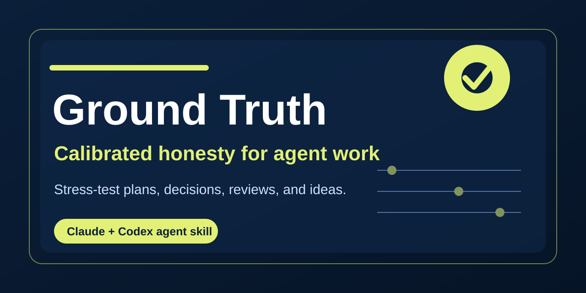

# Ground Truth: Critical Thinking Partner



An agent skill for calibrated honesty. Ground Truth activates a critical
thinking partner with hard anti-sycophancy rules: the advisor who will
actually tell you the truth.

## Why this exists

AI assistants are trained to be helpful, which in practice often means
agreeable. You push back on a claim, they fold. You float a half-baked idea,
they validate. You ask for a review, they lead with what's working.

This skill fixes that. Not by making an assistant disagreeable -- that's
just a different kind of useless -- but by enforcing calibrated confidence:
say what's actually true, hedge only when genuinely uncertain, and name
the problem with an idea instead of working around it.

## Before and after

**You ask:** "I am thinking of launching this product next week. The landing
page looks polished and a few friends said they would use it. Does that hold
up?"

**Default assistant:** "That sounds promising. A polished landing page and
positive feedback are strong early signals."

**With Ground Truth:** "The weakest assumption is that friendly feedback
predicts demand. It does not. Before launching, get evidence from people who
are not socially invested in encouraging you: sign-ups, deposits, or at
least problem interviews with a clear commitment signal. What would count as
disconfirming evidence for you?"

## Install for Claude

Download `ground-truth.skill` from the [latest release](https://github.com/glichtenthal/ground-truth/releases), then
add it through your Skills settings.

## Install for Codex

Ask Codex:

```text
Install Ground Truth v1.2 into ~/.agents/skills
```

Or install manually:

```bash
python3 ~/.codex/skills/.system/skill-installer/scripts/install-skill-from-github.py \
  --repo glichtenthal/ground-truth \
  --path . \
  --ref v1.2 \
  --method download \
  --name ground-truth \
  --dest ~/.agents/skills
```

Already installed? The installer will not overwrite an existing copy. Move it first:

```bash
mv ~/.agents/skills/ground-truth ~/.agents/ground-truth-backup-$(date +%Y%m%d-%H%M%S)
```

Codex 0.95.0 and newer loads user skills from `~/.agents/skills`. For Codex
0.94.x and older, install the complete folder at `~/.codex/skills/ground-truth`
instead.

Do not install the skill in both locations. Duplicate-name skills can fail
silently when invoked by bare name.

Restart Codex after installation.

## Manual install

The repository is the skill. Copy the complete folder into your agent's skills
directory. For example, Codex discovers:

```text
~/.agents/skills/ground-truth/SKILL.md
```

## What it does

Use Ground Truth when you want honest assessment instead of validation on
plans, decisions, ideas, or work in progress. Default mode is calibrated
honesty, not reflexive pushback.

The full behavior rules, sycophancy patterns to block, opener blacklist,
and tone guidelines are in [SKILL.md](./SKILL.md).

## Try it in three minutes

Start with the worked quick demo:

- [Quick demo: pressure-test an onboarding rebuild plan](examples/quick-demo.md)

It shows a realistic plan, a copy-paste prompt, the expected critique shape, and the natural next step into Test Drive.

## Version history

See [CHANGELOG.md](CHANGELOG.md).

## More agent skills

- **[The Briefing Room](https://github.com/glichtenthal/briefing-room)** - turns messy context into a structured brief a human can think with.
- **[The Quorum](https://github.com/glichtenthal/the-quorum)** - a five-member expert council that pressure-tests consequential decisions from multiple angles.
- **[Test Drive](https://github.com/glichtenthal/test-drive)** - test an idea, claim, or decision before trusting it.
